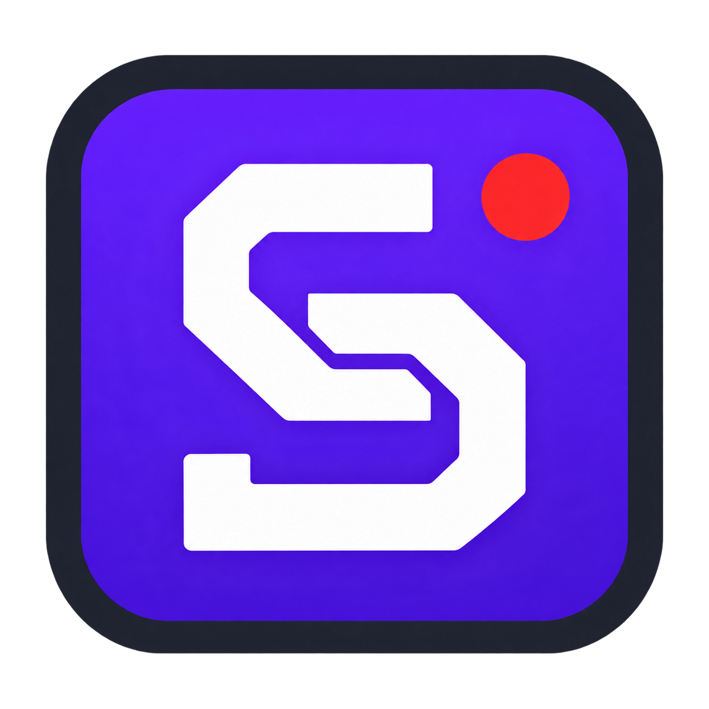

<p align="center"></p>

# Skeebs

**Студия записи экрана для Windows со сценами, слоями и выделением области, для слабых устройств.**

Skeebs объединяет экран, веб-камеру, изображения и надписи в одной сцене. Настройте композицию, выберите качество и начните запись. Интерфейс на русском языке, оформление — тёмное с фиолетовыми акцентами.

## Возможности

- Запись экрана, монитора или прямоугольной области, выделенной мышью.
- Системный курсор в предпросмотре и записи.
- Сцены и слои: порядок, видимость, положение, размер и прозрачность.
- Источники: экран, область экрана, веб-камера, изображение, текст, цвет.
- MKV и MP4; видео H.264, аудио AAC.
- 480p, 720p, 1080p и размер выбранной области; 15/25/30/60 FPS.
- Intel Quick Sync или программный кодировщик CPU / ultrafast.
- Запись одного аудиоисточника: системный звук или микрофон.
- DirectX Desktop Duplication для основного монитора; резервный GDI-захват.
- Предпросмотр с выбором 15/30/60 FPS и возможностью отключения.
- Автоматическое сохранение сцен.

## Скачать и запустить

Архив Windows находится в [Releases](https://github.com/skebobvsearusi/Skeebs/releases).

1. Распакуйте весь ZIP в папку, доступную для записи.
2. Установите **FFmpeg отдельно**: возьмите Windows-сборку по ссылке с [официальной страницы FFmpeg](https://ffmpeg.org/download.html#build-windows), затем положите `ffmpeg.exe` рядом с `Skeebs.exe`. Подойдёт и FFmpeg, установленный в `PATH`.
3. Запустите `Skeebs.exe`. Устанавливать Python для готовой сборки не требуется.

FFmpeg не включён в публичный архив. Папка `_internal` должна оставаться рядом с программой. Это предварительная сборка для Windows x64; она не подписана цифровым сертификатом.

## Как записать область

Нажмите **«Область…»**, выделите прямоугольник мышью и отпустите кнопку. Создастся отдельная сцена, а разрешение будет соответствовать выделению. Затем нажмите **«Начать запись»**. Esc отменяет выделение. Фиксируется участок экрана, а не само окно приложения.

Записи сохраняются в **`save video` рядом с программой**. Другой каталог можно выбрать кнопкой «Выбрать папку…» на текущий сеанс. Чтобы завершить запись, нажмите «Остановить запись» и дождитесь сообщения о сохранении.

Сверните Skeebs, если его окно попадает в захват. Не перемещайте записываемое окно за пределы выделенной области.

## Сцены и источники

Добавляйте сцены и источники кнопками «+». Верхний слой перекрывает нижние. Галочка скрывает источник, стрелки меняют порядок. Перемещайте выбранный слой мышью; справа задавайте размеры и прозрачность. Двойной щелчок по текстовому источнику позволяет изменить надпись.

Проект хранится в `%LOCALAPPDATA%/Skeebs/project.json`. Изображения остаются по исходным путям и не встраиваются в проект. Журналы находятся в той же папке настроек.

## Производительность и ограничения

Начальные настройки: **720p, 30 FPS, качество 20, Intel Quick Sync**. Для чёткости мелкого текста выбирайте разрешение монитора. При ошибке аппаратного кодировщика переключитесь на CPU / ultrafast. Частота FPS — целевая: результат зависит от оборудования, источников и нагрузки. Счётчик показывает частоту захвата и повторённые кадры при отставании.

Это базовая студия записи, а не полная замена OBS. Пока нет трансляций, отдельного захвата игры или окна, браузерных источников, видеофайлов как источников, фильтров, переходов, глобальных горячих клавиш и смешивания нескольких аудиоисточников. При закрытии во время записи сначала сохраняется файл; после этого окно нужно закрыть повторно.

Звук временно сохраняется в WAV и присоединяется после остановки. Для длительной записи требуется свободное место. Камера выбирается по индексу, встроенная обычно имеет индекс 0. Работа на нескольких мониторах с разным масштабом Windows не проверялась.

## Запуск из исходников

Проверенная среда: Windows 10 x64, Python 3.14. Нужен FFmpeg в `PATH` или рядом со `skeebs.py`.

```powershell
python -m venv .venv
.venv\Scripts\python.exe -m pip install -r requirements.txt
.venv\Scripts\python.exe skeebs.py
```

Для сборки `.exe` запустите `build.ps1` из PowerShell в каталоге репозитория. Скрипт создаёт собственное окружение и папку `dist/Skeebs`.

## Компоненты

Python, PySide6 / Qt, DXcam, MSS, OpenCV, NumPy, SoundCard и отдельно устанавливаемый FFmpeg. Skeebs написан на Python; `.exe` собирается PyInstaller. Иконка создана с помощью генератора изображений.

Сведения о сторонних компонентах: [THIRD_PARTY.md](THIRD_PARTY.md). Лицензия собственного кода Skeebs пока не выбрана; публикация репозитория сама по себе не означает выдачу лицензии MIT. Лицензии сторонних компонентов действуют отдельно.
